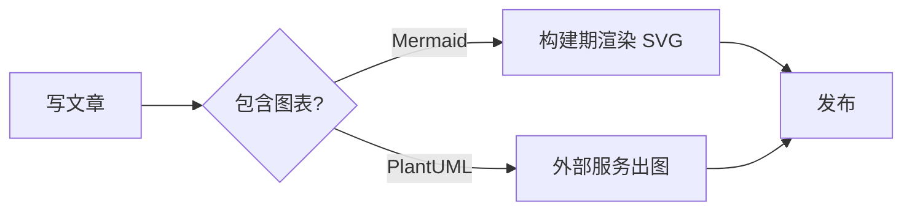
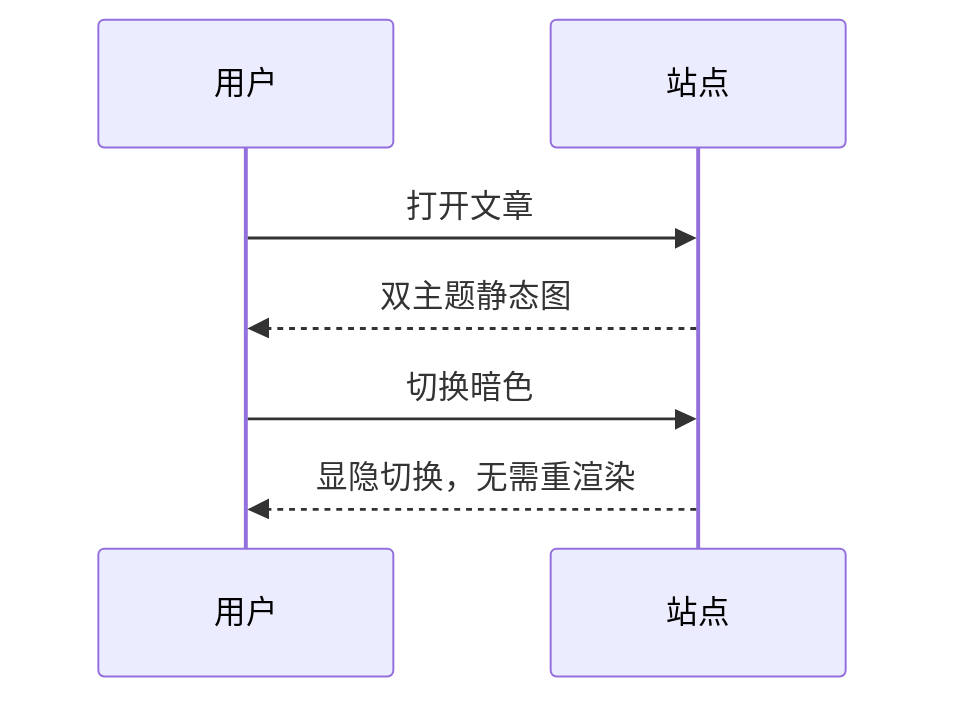
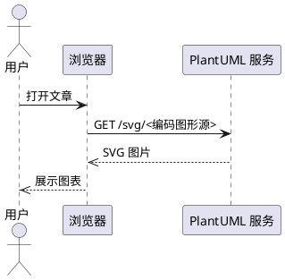
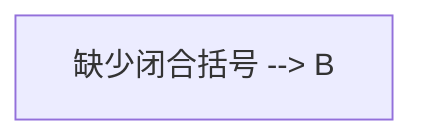

本文演示主题内置的各类内容增强特性，全部特性均通过主题注册的 unified processor 在构建期完成处理，无需站点额外配置。

## 行内与块级公式

行内公式：质能方程 $E = mc^2$，以及 $\int_0^\infty e^{-x}\,dx = 1$。

块级公式（Gaussian 积分）：

$$
\int_{-\infty}^{\infty} e^{-x^2} \, dx = \sqrt{\pi}
$$

矩阵与对齐：

$$
A = \begin{pmatrix} a_{11} & a_{12} \\ a_{21} & a_{22} \end{pmatrix},
\quad
\det A = a_{11}a_{22} - a_{12}a_{21}
$$

## 化学方程式（mhchem）

$$
\ce{2H2 + O2 -> 2H2O}
$$

$$
\ce{SO4^2- + Ba^2+ -> BaSO4 v}
$$

## Mermaid 流程图

## PlantUML 时序图

## 邮箱防爬

联系邮箱：<a href="mailto:hi@example.com">hi@example.com</a>（构建期已编码，查看源码无明文 mailto）。

## 渲染失败的降级形态

下面这段 Mermaid 语法是故意错误的，应降级为错误提示 + 源码展示：

## 图片网格（[grid]）

同段形态——四图一行写完，自动四列：

[grid][/grid]

跨段形态——两图带 title（渲染为 figcaption），自动两列：

[grid]

[/grid]

## GitHub 仓库卡片

::github{repo="iwinder/qy-astro-theme-orchid"}

::github{repo="withastro/astro"}

## Callout 扩充（26 种）

GitHub 原生六种之外的别名，例如 SUCCESS / QUESTION / QUOTE：

> [!SUCCESS]
> 成功提示，绿色配色 + 对勾图标。

> [!QUESTION]
> 问题提示，帮助图标（问号圆圈）。

> [!QUOTE]
> 引用提示，中性灰配色。

自定义标题——`[!NOTE]` 同一行剩余文字会成为标题：

> [!NOTE] 这是一个自定义标题
> 标题由标记同行的剩余文字提取，正文从这里开始。

容器指令形态（remark-directive）——`:::note` 转为 callout 渲染：

:::note
这是一个 note 容器指令，与 `> [!NOTE]` 等价。
:::

带 label 的容器——`:::tip[容器自定义标题]`：

:::tip[容器自定义标题]
label 会被提取为 callout 标题。
:::
