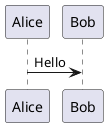

文章是 `.md` / `.mdx` 文件，放进 `src/content/posts/` 即被收集。
本文给全 frontmatter 字段表与主题提供的**全部写作增强语法**。

## 新建文章

```bash
pnpm --filter site new-post "我的新文章"
# 或在 site 目录内：node scripts/new-post.mjs "我的新文章"
```

脚手架按模板生成带好 frontmatter 骨架的 `.md` 文件，改完正文即可。
文章文件名即 URL slug，建议用英文短横线命名（如 `my-first-post.md` → `/posts/my-first-post/`）。

## frontmatter 全部字段

schema 由主题的 `definePostSchema()` 提供（站点可在 `content.config.ts` 里传入 extensions 扩展）：

| 字段 | 类型 | 默认值 | 说明 |
|---|---|---|---|
| `title` | `string` | **必填** | 标题 |
| `description` | `string` | `""` | 摘要（列表卡、OG 图、RSS 用；留空取正文首段） |
| `published` | `date` | **必填** | 发布日期 `YYYY-MM-DD` |
| `updated` | `date` | — | 更新日期（过时提醒以此为准） |
| `draft` | `boolean` | `false` | 草稿：**本地 dev 可见，生产构建剔除**（列表/归档/RSS/API 全部不输出） |
| `pinned` | `boolean` | `false` | 置顶（列表最前） |
| `image` | `string` | — | 封面图；特殊值 `"api"` 走随机封面（见[文章列表与归档](/posts/postlist-and-archive/#随机封面-randomcover)） |
| `tags` | `string[]` | `[]` | 标签 |
| `category` | `string` | — | 分类（单值） |
| `password` | `string` | — | **非空即加密文章**（见下） |
| `passwordHint` | `string` | `""` | 解锁提示 |
| `lang` | `string` | 站点 `lang` | 本篇语言 |
| `author` | `string` | 站点 `author` | 本篇作者 |
| `sourceLink` | `string` | `""` | 原文链接（转载文章署名） |
| `license` | `boolean` | `true` | 本篇是否显示版权声明 |
| `licenseName` / `licenseUrl` | `string` | 全局 license 配置 | 本篇覆盖许可证 |
| `comment` | `boolean` | `true` | 本篇是否开评论区 |
| `cardStyle` | `"cover" \| "compact" \| "text"` | 全局 postList.style | 本篇列表卡形态 |
| `series` / `seriesOrder` | `string` / `number` | — | 专题名与序号（小在前），聚合到 `/series/<name>/` |
| `seriesGroup` | `string` | — | 专题内分组名（如「入门」「基础配置」），专题页与专题目录按组分块展示 |

最小可用 frontmatter 只有两个必填项：

```yaml
---
title: 我的第一篇文章
published: 2026-10-18
---
```

## 加密文章

frontmatter 加 `password` 即成为加密文章：

```yaml
---
title: 仅限好友阅读
published: 2026-10-18
password: "my-secret"
passwordHint: "我们的暗号"
---
```

- 未解锁时正文不进 HTML——**内容在构建产物里就不存在**，不是前端遮罩
- 加密文章不进相关/随机推荐池，RSS 与 `/api/allPostMeta.json` 不泄露内容
- 评论区在解锁后才加载

## MDX 与注意事项

`.mdx` 可在文章里直接写组件（import 后当 JSX 用）。已知坑：

> [!warning]
> MDX 内联 `<style>` 标签会因 `style-to-js` 解析报错。CSS 请写进独立样式文件，
> 或使用 `<style is:inline>` 规避。

纯 Markdown 写作不受影响；不确定要不要组件时用 `.md` 即可。

## 写作增强语法

### 提示块（admonition）

`:::type` 容器 + 内容 + `:::`，支持 **26 种类型**（GitHub 6 种 + Obsidian 扩充别名）：
`note` / `tip` / `important` / `warning` / `caution` / `abstract`（`summary`、`tldr`）/
`info` / `todo` / `success`（`check`、`done`） / `question`（`help`、`faq`）/
`attention` / `failure`（`missing`、`fail`） / `danger`（`error`） / `bug` / `example` / `quote`（`cite`）。

```markdown
:::note
普通提示。
:::

:::warning[自定义标题]
警告内容，方括号自定义标题。
:::
```

渲染为带图标的彩色提示卡片，深浅模式自适应（本文多处演示）。

### GitHub 仓库卡片

```markdown
::github{repo="iwinder/qy-astro-theme-orchid"}
```

::github{repo="iwinder/qy-astro-theme-orchid"}

渲染为仓库名、描述、星标数的卡片，数据构建期抓取。

### 图片网格

`[grid]` 与 `[/grid]` 包住多张图片，自动等宽排布：

```markdown
[grid]


[/grid]
```

### 数学公式（LaTeX）

`latex.enabled: true` 时可用（见[文章页功能](/posts/post-features/)）：

- 行内：`$E = mc^2$` → $E = mc^2$
- 块级：`$$\int_a^b f(x)\,dx$$` 独占一行渲染
- 化学方程式（mhchem）：`$\ce{H2O}$` → $\ce{H2O}$

### 图表

围栏代码块直接写（`diagram` 配置见[文章页功能](/posts/post-features/)）：

````markdown

````



mermaid 构建期渲染为双主题静态 SVG；plantuml 经渲染服务出图（可自建 `server`）。

### 代码块增强

代码块由 Expressive Code 渲染（配置见[文章页功能](/posts/post-features/)），
自带复制按钮、行号；超长块自动折叠。meta 上支持语言标注与标题：

````markdown
```ts title="src/config.ts"
export const ok = true;
```
````

## 专题（series）

frontmatter 同填 `series` 与 `seriesOrder` 即入组：

```yaml
---
title: 指南第一篇
series: 主题使用指南
seriesGroup: 入门
seriesOrder: 1
---
```

- 同系列按 `seriesOrder` **升序**排列；未配置序号的文章按发布时间排
- `seriesGroup` 非空时进入分组展示：未分组文章排在最前，各分组按组内首篇顺序依次排列，序号跨组连续——同组文章的 `seriesOrder` 建议保持连续区段，阅读动线更顺
- `/series/` 聚合全部专题，`/series/<name>/` 展示单系列（含前后篇导航）
- 本系列就是用这套机制组织的（入门 → 基础配置 → 功能配置 → 进阶）——从[快速开始](/posts/getting-started/)回看全部篇目
